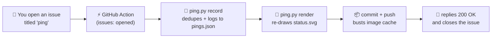

Click the button, then hit <b>Create</b>. A GitHub Action logs your ping in the terminal above and replies to you within a minute.

---

### 🛠️ Tech Stack

  

---

### 📊 GitHub Stats

  
  

  

  

---

<b>⚙️ How the ping works</b>

 

Every ping is a tiny event-driven pipeline, built entirely on GitHub:

- **Rate limiting:** pinging again within 30 minutes gets a friendly `429` instead of a duplicate log entry.
- **Safe by design:** only your GitHub username is shown, never free text from the issue.
- **Concurrency:** runs are serialized so simultaneous pings never clobber each other.

Source: [`ping.yml`](.github/workflows/ping.yml) · [`ping.py`](scripts/ping.py)

